<br/><br/><br/>
# **Welcome to**
# **Thoughtspot**

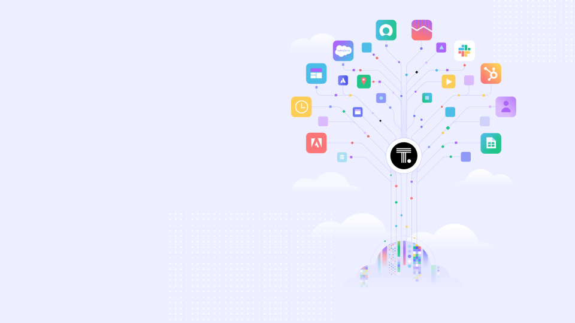

---
<br/><br/><br/>
# **Access Control**
##### **With**
## **Zanzibar & SpiceDB**


---
<br/><br/><br/><br/>
### **Access Control**

* Types of access control

---
#### **ACL (Access Control List)**

Example: File systems (Linux file permissions).

Pros: Simple, direct.
Cons: Becomes unmanageable as system scales.

---
#### **RBAC (Role-Based Access Control)**

Access is determined based on user roles (e.g., admin, editor, viewer).

Example: Corporate apps where permissions are granted based on job function.

Pros: Easier to manage roles.

Cons: Lack of granularity for specific tasks.

---
#### **ABAC (Attribute Based Access Control)** 

Access is based on user, resource, or environmental attributes (e.g., time, location).

Example: Bank systems where attributes like account type, user location determine access.

Pros: Dynamic, flexible.

Cons: Complex to configure and manage.

---

#### **ReBAC (Relationship Based Access Control)** 

- Defines access permissions based on the relationships between users and resources
- Granular and Flexible: It allows for more granular and flexible permission management, especially for complex hierarchies of users, resources, and permissions.
- Dynamic Authorization: ReBAC dynamically evaluates access requests based on the current relationships (e.g., friend, owner, member) rather than static roles.

---

#### **ReBAC (Relationship Based Access Control)** 

- Policy Driven: Access policies are driven by the relationships and can be updated without changing the code, making the system more maintainable.
- Examples of Use: Google Drive's sharing system, where permissions are based on who owns or has been granted access to a file, is a classic example of ReBAC in action.

--- 
<br/><br/><br/><br/>
## **Access Control ?**

---
<br/><br/><br/><br/>
## **Broken ~~Access Control~~ !!**
* ### 1 on OWASP's Top 10

---

### **Natural Progression of Authorization Systems**

<div class="mermaid mer_center">
flowchart LR
adHoc --> Library --> NetworkService
</div>

---

<br/><br/><br/><br/>

### **Why are we looking at a Permission System?**

---

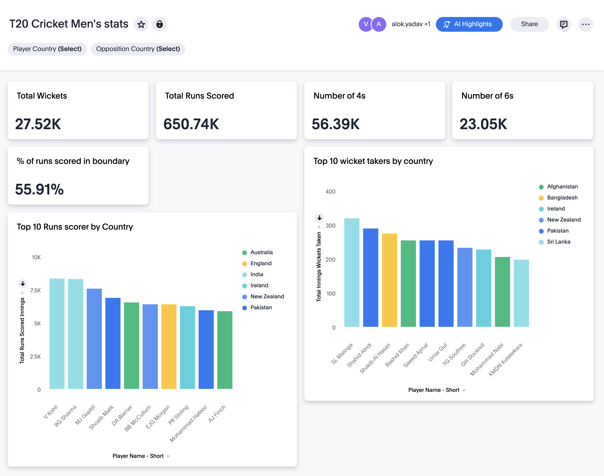

---

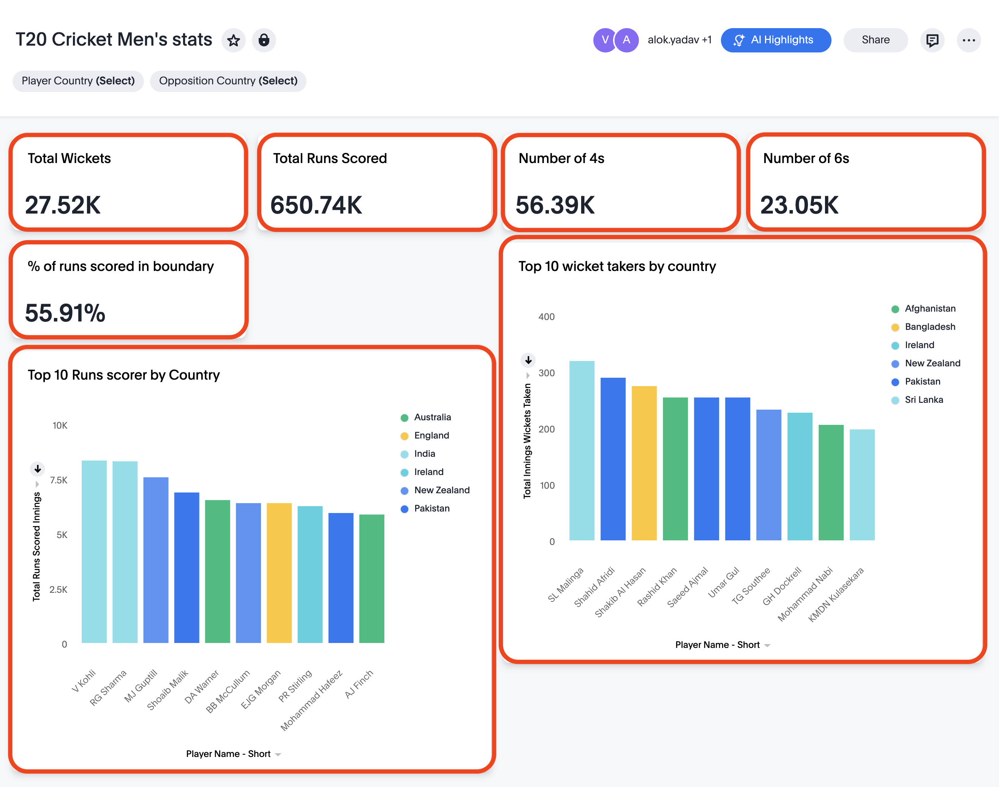


---
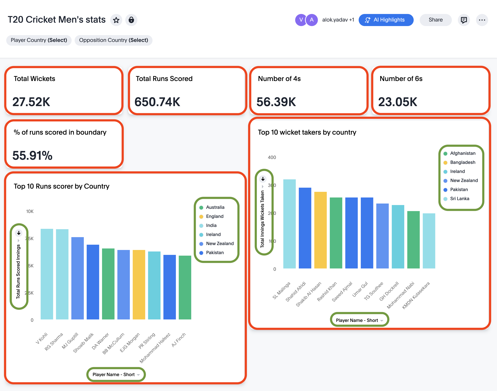

---

#### **Representation as a Graph**


<div class="mermaid">
flowchart LR
Liveboard -->Container --> Answers
Answers --> Columns -->Columns
Tables --> Columns
</div>

---

#### **Let's Flatten the Graph out with some examples**


<div class="mermaid">
flowchart LR
Lb:T20Cricket --> container:NumberOf6s
Lb:T20Cricket --> container:NumberOf4s
Lb:T20Cricket --> container:Top10Runs
Lb:T20Cricket --> container:Top10Wickets
container:NumberOf6s --> ans:NumberOf6s
container:NumberOf4s --> ans:NumberOf4s
container:Top10Runs --> ans:Top10Runs
container:Top10Wickets --> ans:Top10Wickets
ans:NumberOf6s -->col:numberOf6s
ans:NumberOf4s -->col:numberOf4s
ans:Top10Runs -->col:Player
ans:Top10Runs -->col:totalRuns
ans:Top10Runs -->col:country
ans:Top10Runs -->col:Player
ans:Top10Runs -->col:totalWickets
ans:Top10Runs -->col:country
</div>

---

#### **Now with its respective WorkSheet**


<div class="mermaid">
flowchart LR
Lb:T20Cricket --> container:NumberOf6s
Lb:T20Cricket --> container:NumberOf4s
Lb:T20Cricket --> container:Top10Runs
Lb:T20Cricket --> container:Top10Wickets
container:NumberOf6s --> ans:NumberOf6s
container:NumberOf4s --> ans:NumberOf4s
container:Top10Runs --> ans:Top10Runs
container:Top10Wickets --> ans:Top10Wickets
ans:NumberOf6s --> col:numberOf6s
ans:NumberOf4s --> col:numberOf4s
ans:Top10Runs --> col:Player
ans:Top10Runs --> col:Runs
ans:Top10Runs --> col:country
ans:Top10Runs --> col:Player
ans:Top10Runs --> col:Wickets
ans:Top10Runs --> col:country
subgraph WorkSheet
  WorkSheet:cricketT20 --> col:numberOf6s
  WorkSheet:cricketT20 --> col:numberOf4s
  WorkSheet:cricketT20 --> col:Player
  WorkSheet:cricketT20 --> col:Runs
  WorkSheet:cricketT20 --> col:country
  WorkSheet:cricketT20 --> col:Wickets
end

</div>

---

#### **Let's add their tables as well!**


<div class="mermaid">
flowchart LR
Lb:T20Cricket --> container:NumberOf6s
Lb:T20Cricket --> container:NumberOf4s
Lb:T20Cricket --> container:Top10Runs
Lb:T20Cricket --> container:Top10Wickets
container:NumberOf6s --> ans:NumberOf6s
container:NumberOf4s --> ans:NumberOf4s
container:Top10Runs --> ans:Top10Runs
container:Top10Wickets --> ans:Top10Wickets
ans:NumberOf6s --> col:numberOf6s
ans:NumberOf4s --> col:numberOf4s
ans:Top10Runs --> col:Player
ans:Top10Runs --> col:Runs
ans:Top10Runs --> col:country
ans:Top10Runs --> col:Player
ans:Top10Runs --> col:Wickets
ans:Top10Runs --> col:country
subgraph table:t20Teams
  t20Teams --> col:t20Teams.player_id
  t20Teams --> col:t20Teams.player_name
  t20Teams --> col:t20Teams.country_name
end
subgraph table:t20Runs
  t20Runs --> col:t20Runs.player_id
  t20Runs --> col:t20Runs.runs
end
subgraph table:t20Wickets
  t20Wickets --> col:t20Wickets.player_id
  t20Wickets --> col:t20Wickets.wicket
end
subgraph WorkSheet:cricketT20
  cricketT20 --> col:numberOf6s --> col:t20Runs.runs
  cricketT20 --> col:numberOf4s --> col:t20Runs.runs
  cricketT20 --> col:Player --> col:t20Teams.player_name
  cricketT20 --> col:Runs --> col:t20Runs.runs
  cricketT20 --> col:country --> col:t20Teams.country_name
  cricketT20 --> col:Wickets --> col:t20Wickets.wicket
end

</div>

---

#### **What about the Users?**


<div class="mermaid">
flowchart LR
Lb:T20Cricket --> container:NumberOf6s
Lb:T20Cricket --> container:NumberOf4s
Lb:T20Cricket --> container:Top10Runs
Lb:T20Cricket --> container:Top10Wickets
container:NumberOf6s --> ans:NumberOf6s
container:NumberOf4s --> ans:NumberOf4s
container:Top10Runs --> ans:Top10Runs
container:Top10Wickets --> ans:Top10Wickets
ans:NumberOf6s --> col:numberOf6s
ans:NumberOf4s --> col:numberOf4s
ans:Top10Runs --> col:Player
ans:Top10Runs --> col:Runs
ans:Top10Runs --> col:country
ans:Top10Runs --> col:Player
ans:Top10Runs --> col:Wickets
ans:Top10Runs --> col:country
subgraph table:t20Teams
  t20Teams --> col:t20Teams.player_id
  t20Teams --> col:t20Teams.player_name
  t20Teams --> col:t20Teams.country_name
end
subgraph table:t20Runs
  t20Runs --> col:t20Runs.player_id
  t20Runs --> col:t20Runs.runs
end
subgraph table:t20Wickets
  t20Wickets --> col:t20Wickets.player_id
  t20Wickets --> col:t20Wickets.wicket
end
subgraph WorkSheet:cricketT20
  cricketT20 --> col:numberOf6s --> col:t20Runs.runs
  cricketT20 --> col:numberOf4s --> col:t20Runs.runs
  cricketT20 --> col:Player --> col:t20Teams.player_name
  cricketT20 --> col:Runs --> col:t20Runs.runs
  cricketT20 --> col:country --> col:t20Teams.country_name
  cricketT20 --> col:Wickets --> col:t20Wickets.wicket
end
user:user1 --can_read--> Lb:T20Cricket
user:user1 --can_read--> Lb:T20Cricket
user:user1 --can_read--> t20Runs
user:user1 --can_read--> t20Teams
user:user1 --can_read--> t20Wickets
user:user1 --can_read--> cricketT20
</div>

---

#### **What about the Users with nested Groups?**


<div class="mermaid">
flowchart LR
Lb:T20Cricket --> container:NumberOf6s
Lb:T20Cricket --> container:NumberOf4s
Lb:T20Cricket --> container:Top10Runs
Lb:T20Cricket --> container:Top10Wickets
container:NumberOf6s --> ans:NumberOf6s
container:NumberOf4s --> ans:NumberOf4s
container:Top10Runs --> ans:Top10Runs
container:Top10Wickets --> ans:Top10Wickets
ans:NumberOf6s --> col:numberOf6s
ans:NumberOf4s --> col:numberOf4s
ans:Top10Runs --> col:Player
ans:Top10Runs --> col:Runs
ans:Top10Runs --> col:country
ans:Top10Runs --> col:Player
ans:Top10Runs --> col:Wickets
ans:Top10Runs --> col:country
subgraph table:t20Teams
  t20Teams --> col:t20Teams.player_id
  t20Teams --> col:t20Teams.player_name
  t20Teams --> col:t20Teams.country_name
end
subgraph table:t20Runs
  t20Runs --> col:t20Runs.player_id
  t20Runs --> col:t20Runs.runs
end
subgraph table:t20Wickets
  t20Wickets --> col:t20Wickets.player_id
  t20Wickets --> col:t20Wickets.wicket
end
subgraph WorkSheet:cricketT20
  cricketT20 --> col:numberOf6s --> col:t20Runs.runs
  cricketT20 --> col:numberOf4s --> col:t20Runs.runs
  cricketT20 --> col:Player --> col:t20Teams.player_name
  cricketT20 --> col:Runs --> col:t20Runs.runs
  cricketT20 --> col:country --> col:t20Teams.country_name
  cricketT20 --> col:Wickets --> col:t20Wickets.wicket
end
user:user1 --can_read--> Lb:T20Cricket
user:user1 --can_read--> Lb:T20Cricket
user:user1 --can_read--> t20Runs
user:user1 --can_read--> t20Teams
user:user1 --can_read--> t20Wickets
user:user1 --can_read--> cricketT20
group:group2
group:group2 --can_read--> Lb:T20Cricket
group:group2 --can_read--> Lb:T20Cricket
group:group2 --can_read--> t20Runs
group:group2 --can_read--> t20Teams
group:group2 --can_read--> t20Wickets
group:group2 --can_read--> cricketT20
</div>

---
<br/><br/><br/><br/>

#### **Is that all ?**

---

<div class="mermaid">
---
title: Current Atlas Graph
---
flowchart LR
 action_object -- action_object_to_answer_enabled --> answer_spec
 action_object -- action_object_to_answer_with_context_menu_context --> answer_spec
 action_object -- action_object_to_answer_with_primary_context --> answer_spec
 action_object -- action_object_to_logical_table_enabled --> logical_table
 action_object -- action_object_to_logical_table_with_menu_context --> logical_table
 action_object -- action_object_to_user --> user
 action_object -- action_object_to_user_group --> user_group
 answer_spec -- answer_to_referenced_columns --> logical_column
 answer_spec -- answer_to_referenced_parameter --> parameter
 answer_spec -- answer_to_referenced_relationship --> logical_relationship
 answer_spec -- object_to_tag --> tag
 container_spec -- container_to_answer --> answer_spec
 data_source -- data_source_to_load_status --> dataload_stats
 data_source -- data_source_to_table --> logical_table
 data_source -- object_to_tag --> tag
 filter -- filter_to_column --> logical_column
 logical_column -- cohort_to_column --> logical_column
 logical_column -- column_to_calendar_table --> logical_table
 logical_column -- column_to_physical_column --> physical_column
 logical_column -- column_to_referenced_columns --> logical_column
 logical_column -- column_to_referenced_relationships --> logical_relationship
 logical_column -- column_to_referencing_relationship --> logical_relationship
 logical_relationship -- relationship_to_physical_relationship --> physical_relationship
 logical_relationship -- relationship_to_referenced_columns --> logical_column
 logical_table -- calendar_table_to_calendar_statistics --> custom_calendar_stats
 logical_table -- destination_table_to_relationship --> logical_relationship
 logical_table -- logical_to_physical_table --> physical_table
 logical_table -- object_to_referenced_calendar --> logical_table
 logical_table -- source_table_to_relationship --> logical_relationship
 logical_table -- table_to_column --> logical_column
 logical_table -- table_to_filter --> filter
 logical_table -- table_to_parameter --> parameter
 logical_table -- table_to_table_filter --> table_filter
 logical_table -- view_to_referenced_column --> logical_column
 logical_table -- worksheet_lesson_to_referenced_column --> logical_column
 pinboard_spec -- object_to_tag --> tag
 pinboard_spec -- pinboard_filter_to_column --> logical_column
 pinboard_spec -- pinboard_to_container --> container_spec
 pipeline_info -- pipeline_info_to_user --> user
 pipeline_instance_info -- pipelineinstance_to_pipeline --> pipeline_info
 table_filter -- table_filter_to_referenced_columns --> logical_column
 table_filter -- table_filter_to_referenced_relationships --> logical_relationship
 tenant -- tenant_to_group --> user_group
 tenant -- tenant_to_user --> user
 user -- answer_book_modify_permission --> answer_spec
 user -- answer_book_modify_permission --> pinboard_spec
 user -- answer_book_read_permission --> answer_spec
 user -- answer_book_read_permission --> pinboard_spec
 user -- column_modify_permission --> logical_column
 user -- datasource_modify_permission --> data_source
 user -- table_modify_permission --> logical_table
 user -- table_read_permission --> logical_table
 user -- table_read_permission --> pinboard_spec
 user -- user_favorite_object --> answer_spec
 user -- user_favorite_object --> pinboard_spec
 user -- user_home_pinboard --> pinboard_spec
 user -- user_to_datasource_auth_info --> datasource_auth_info
 user -- user_to_encrypted_password --> user_authinfo
 user -- user_to_group --> user_group
 user -- user_to_profile_image --> file
 user -- user_to_tenant --> tenant
 user -- user_to_user_activity --> user_activity
 user_group -- answer_book_modify_permission --> answer_spec
 user_group -- answer_book_modify_permission --> pinboard_spec
 user_group -- answer_book_read_permission --> answer_spec
 user_group -- answer_book_read_permission --> pinboard_spec
 user_group -- datasource_modify_permission --> data_source
 user_group -- group_to_group --> user_group
 user_group -- group_to_role --> role
 user_group -- group_to_tenant --> tenant
 user_group -- table_modify_permission --> logical_table
 user_group -- table_read_permission --> logical_table
 user_group -- table_read_permission --> pinboard_spec
 logical_table -- object_to_tag --> tag
</div>

---
### **Enterprise Readiness**

- Multi-model
- Work across applications
- Permissions visibility
- Correct / Consistent

---
### **Google's Requirements**

* Trillions of objects
* Billion's of customers
* Million's of requests per second
* Quickly
* Reliably
* Multi-Region

---
### **This brings us to the Zanzibar Paper**

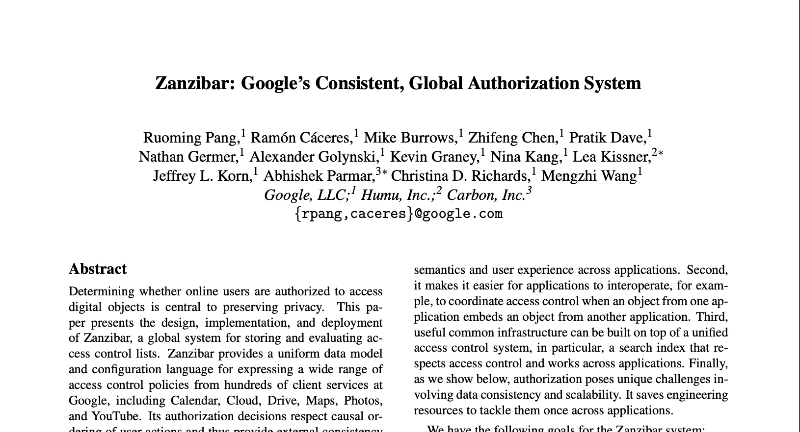

---
### **Sections to Cover**

2. Model Language and API.
3. Architecture and Implementation
4. Performance

---

<br/><br/><br/><br/>

### **2. Model Language and API**

---

#### Lexicon

- User
- Object
- Relation
- Relation Tuples
- Namespaces

---
##### User

- Represents a natural person or service account
- Assigned a globally unique ID

---
##### Object

- Represents a non-user entity
- Unique Identifier prefixed with an object Type

---
##### Relation

- The way one object can be related to another object or user.
- Examples:
  - `member` of a group
  - `editor` of a Document
  - `author` of a video

---
##### Relation Tuples

- Datum which expresses a single relationship
- Very understandable notation
- `document:123#owner@3`
  - User `3` is an `owner` of a `document` with identifier `123`
- `document:123#owner@user:3` **In SpiceDb**

---
##### Relation Tuples

Object can relate to other objects

- `group:engineering#member@group:security`
- *group* `security` is a direct **member** of the *group* `engineering`

---
##### Namespaces

- Define object types
- ... and their relations
- Instructions to reinterpret relationships

---

### Example Schema

<div class="colwrap">

* <div class="left">
  <div class="mermaid">
  flowchart LR
  subgraph User
  end
  subgraph Table
      treader["reader"]
      teditor["editor"]
  end
  subgraph Column
      creader["reader"]
      ceditor["editor"]
      ctable["table"]
  end
  treader --> User
  teditor --> User
  creader --> User
  ceditor --> User
  ctable --> Table
  </div>
  </div>

- <div class="right">

  ```bash
  definition user {}

  definition table {
      relation reader: user
      relation editor: user
  }

  definition column {
      relation reader: user
      relation editor: user
      relation table: table
  }
  ```
  </div>
</div>

---
### The API

- Relation Tuple CRUD operations
- Watch changes
- Expand relation on an object
- Check permission
  - With bounded staleness

---
### Example Data

<div class="colwrap">

* <div class="left">
  <div class="mermaid">
  flowchart LR
  subgraph User
      direction LR
      u_hr["user:hr"]
      u_mgr["user:manager"]
      u_sec["user:security"]
  end
  subgraph Tables
      direction LR
      employee_table["table:employee"]
  end
  subgraph Columns
      direction LR
      name["column:name"]
      email["column:email"]
      salary["column:salary"]
  end
  name --table--> employee_table
  email --table--> employee_table
  salary --table--> employee_table
  employee_table --editor--> u_hr
  employee_table --reader--> u_mgr
  name --reader--> u_sec
  email --reader--> u_sec
  </div>
  </div>
- <div class="right">

  ```bash
  column:name#table@table:employee
  column:email#table@table:employee
  column:salary#table@table:employee

  table:employee#editor@user:hr
  table:employee#reader@user:manager

  column:name#reader@user:security
  column:email#reader@user:security
  ```
  </div>
</div>


---
### Example Permission Check

<div class="colwrap">

- <div class="right">
  <div class="mermaid">
  flowchart LR
  subgraph User
      direction LR
      u_hr["user:hr"]
      u_mgr["user:manager"]
      u_sec["user:security"]
  end
  subgraph Tables
      direction LR
      employee_table["table:employee"]
  end
  subgraph Columns
      direction LR
      name["column:name"]
      email["column:email"]
      salary["column:salary"]
  end
  name --table--> employee_table
  email --table--> employee_table
  salary --table--> employee_table
  employee_table --editor--> u_hr
  employee_table --reader--> u_mgr
  name --reader--> u_sec
  email --reader--> u_sec
  </div>
  </div>

- <div class="left">
  <ul>
  <li>
    <code>column:salary#view@user:hr</code>
  </li>
  <li data-marpit-fragment="1" data-bespoke-marp-fragment="active">
    <code>Column: permission view</code>
  </li>
  <li data-marpit-fragment="2" data-bespoke-marp-fragment="active">
    <code>= reader</code>
  </li>
  <li data-marpit-fragment="3" data-bespoke-marp-fragment="active">
    <code>= reader + table-&gt;view</code>
  </li>
  <li data-marpit-fragment="4" data-bespoke-marp-fragment="active">
    <code>= editor + reader + table#reader</code>
  </li>
    <li data-marpit-fragment="5" data-bespoke-marp-fragment="active">
    <code>= editor + reader + table-&gt;view</code>
  </li>
  </ul>
  </div>

</div>


---
### Example Complete Schema

```bash
definition user {}

definition table {
    relation reader: user
    relation editor: user
    permission view = edit + reader
    permission edit = editor
}

definition column {
    relation reader: user
    relation table: table
    permission view = reader + table->view
    permission edit = table->edit
}
```

---

<br/><br/><br/><br/>

## Let's head to Authzed playground to recap what we went through so far

---
### **Zookies/zedtoken (Zanzibar cookies)**

- Represent a specific point in time
- Forces check requests with data "at least as fresh"
- Opaque to the caller
- Live with data, updated when the data is updated
- Solves the new enemy problem

---
### New Enemy Problem

- Apply old ACL's to new content
- Evaluates changes to ACL's out of order

---
### New Enemy Problem: Example

* Himanshu & Shreya has read permission on a Document
  * T1 -> Admin removes reader permission from Himanshu
  * T2 -> Shreya adds a secret plan to the document
  * T3 -> Himanshu attempts to read document
    * Stale ACL is used
    * Himanshu sees secret plan

---
### New Enemy Problem: Example with (Zookies)

* Himanshu & Shreya has read permission on a Document
  * T1 -> Admin removes reader permission from Himanshu
  * T2 -> Shreya adds a secret plan to the document
    * Get's and updates zookie for the document
  * T3 -> Himanshu attempts to read document
    * T2 zookie is sent with the access request
    * Fresh enough ACL is used
    * Himanshu's Access is denied
  * Crisis is averted !!

---
<br/><br/><br/><br/>

# **Section 3: Architecture and Implementation**

---
## **Architecture Diagram**

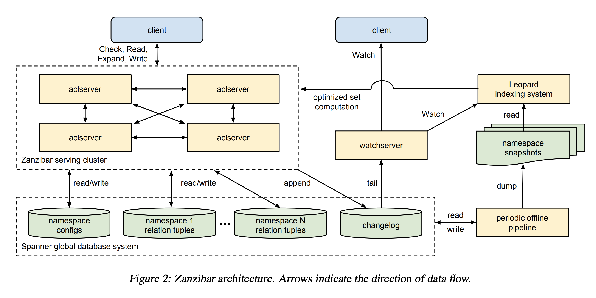

---
### **Globally Distributed**

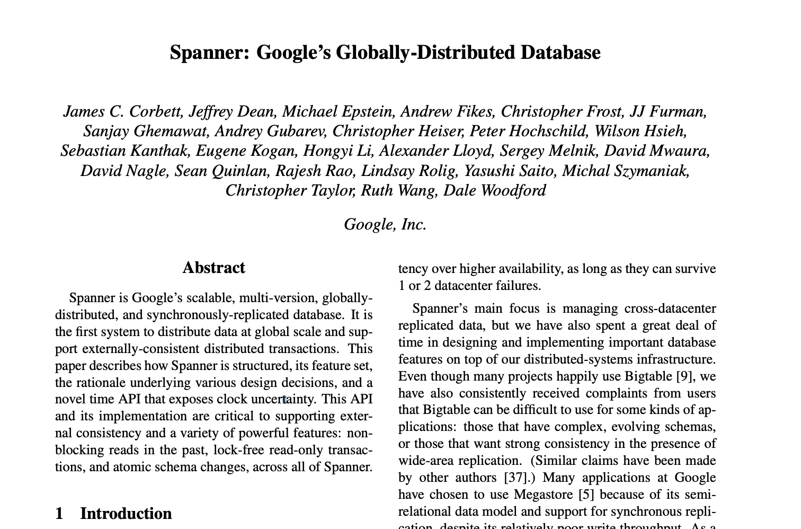

---
### **Spanner Performance**

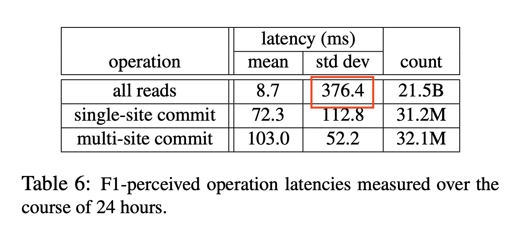

---
### **Spanner Performance**

<br/><br/><br/>

### Need to make as few call's to spanner as possible

---
### **Performance Strategies**

- Break down into parallel sub-problems
- Cache every problem and sub-problem
- Reuse cache as much as possible
- De-duplicate requests
- Batch reads to datastore
- Pre-compute group transitive closure: Leopard cache

---
### **Break down into parallel sub-problems**

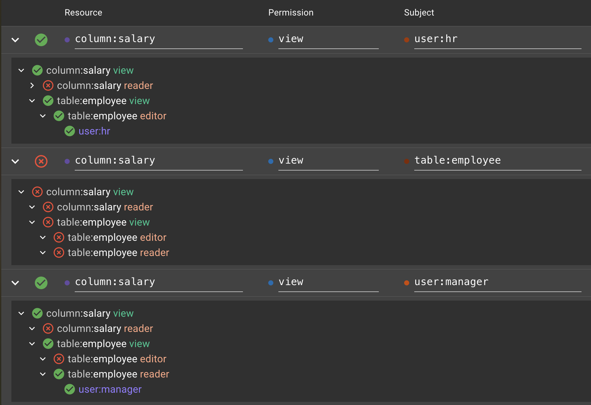

---
### **Improving Cache Hit Rate**

- Distribute sub-problems to nodes likely to have answer
- Leverage: immutable decisions at a given timestamp
- Pick timestamps with globally replicated data
- Pick timestamps that can be shared

---
#### **Slicer: Google's strategy for distributed cache**

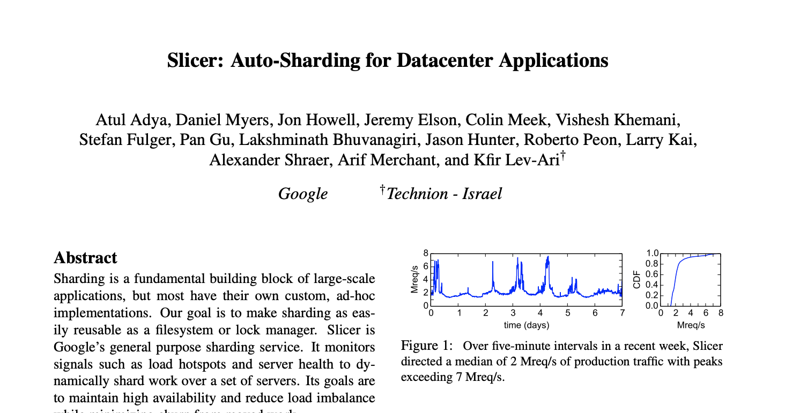

---
#### **Picking a timestamp**

- From our example of Admin removing Himanshu's reader permission.
- We can pick any cached ACL for that document as long as it's after T2.

---
#### **Cache Hit Rates**
<br/>

# ~98%
<br/>

## Cache hit rate for one Himeji implementation

---
<br/><br/><br/><br/>

## **Section 4 : Performance**

---
### **Latency**

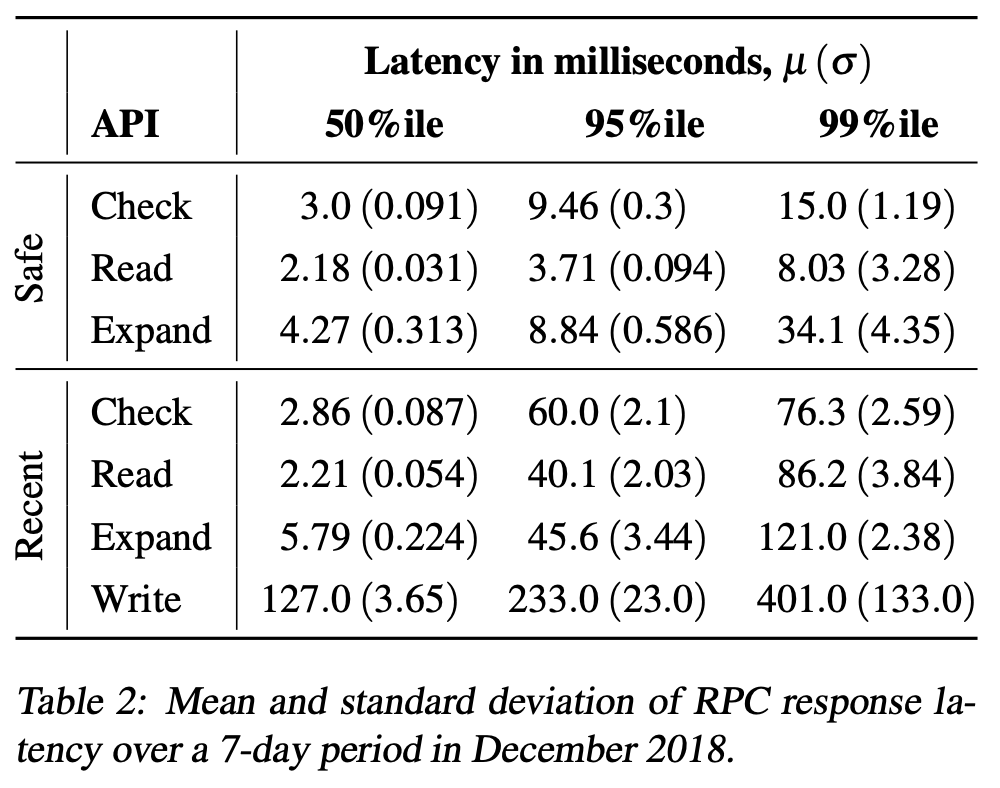

---
### **Scale at google Zanzibar**

> Zanzibar serves more than 10 million client queries per second (QPS). over a sample 7-day period in December 2018.
  Check requests peak at roughly 4.2M QPS

---

## **SpiceDb Architecture**

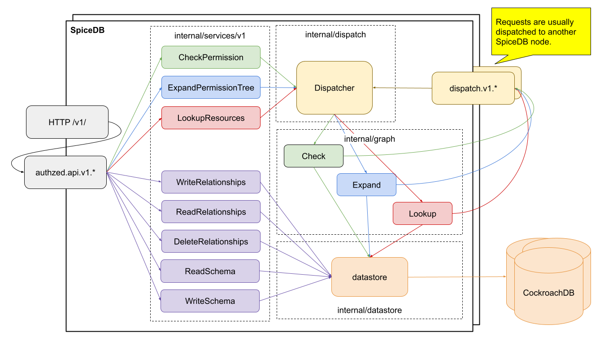

---
## **Dispatch**

```go
type Dispatcher interface {
   Check
   Expand
   Lookup
   // Close closes the dispatcher.
   Close() error
}
type Check interface {
   // DispatchCheck submits a single check request and returns its result.
   DispatchCheck(ctx context.Context, req *v1.DispatchCheckRequest) (*v1.DispatchCheckResponse, error)
}
type Expand interface {
   // DispatchExpand submits a single expand request and returns its result.
   DispatchExpand(ctx context.Context, req *v1.DispatchExpandRequest) (*v1.DispatchExpandResponse, error)
}
type Lookup interface {
   // DispatchLookup submits a single lookup request and returns its result.
   DispatchLookup(ctx context.Context, req *v1.DispatchLookupRequest) (*v1.DispatchLookupResponse, error)
}
```
---
### **Dispatch Request Type: Graph Request**

- Converts relationships and schema into a directed graph to determine permissions.
- Responsible for traversing the graph to compute answers or break requests into sub-requests.
- Uses the internal/graph package for this traversal and computation process.
- Sub-requests may be passed to other dispatchers if they involve cacheable sub-problems or require further computation.

---
### **Dispatch Request Type: Remote Dispatch**

- Distributes sub-requests to other SpiceDB servers to parallelize processing across multiple servers.
- Improves performance by utilizing a larger compute and network infrastructure.
- Sends sub-requests to specific servers using a consistent-hash mechanism, aiming for high cache hit rates.
- Each server maintains a cache of recent computed answers, enabling faster responses from previously solved sub-problems.

---
### **Dispatch Request Type: Caching Dispatch**

- Handles both client-side and server-side caching using a unified caching implementation of the dispatch interface.
- Transforms requests into stable cache-keys, retrieves answers from the local cache if available, and caches successful responses.
- Functions as a server-side cache when used between the server handler and the graph dispatcher, and as a client-side cache when placed between the graph dispatcher and the remote dispatcher.
- Ensures efficient reuse of answers for frequently occurring queries, reducing computation load.


---
### **Performance Benchmarks SpiceDB**

External Link: https://authzed.com/blog/google-scale-authorization


---
<br/><br/><br/><br/>

#### **Questions?**
---
<br/><br/><br/><br/>

#### **Thank you**

<script type="module">
import mermaid from 'https://cdn.jsdelivr.net/npm/mermaid@11/dist/mermaid.esm.min.mjs';
mermaid.initialize({ startOnLoad: true });
window.addEventListener('vscode.markdown.updateContent', function() { mermaid.init() });
</script>
