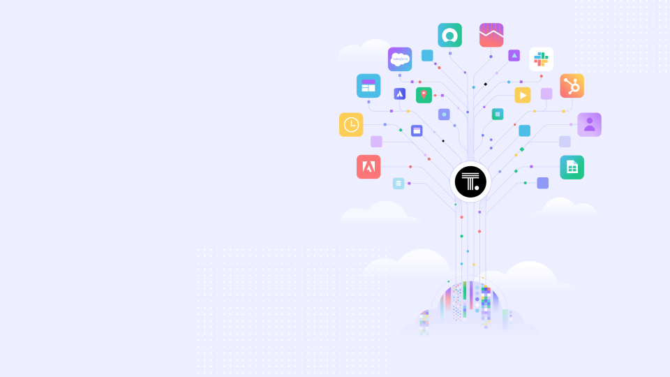

  

# **TDD**
* ## **T**est
* ## **D**riven
* ## **D**evelopment

---
#### **Current Metadata Data Stores in ThoughtSpot**

---
    

# **Why a graph database?**

---

---
    

#### **Questions?**
---
    

#### **Thank you**

